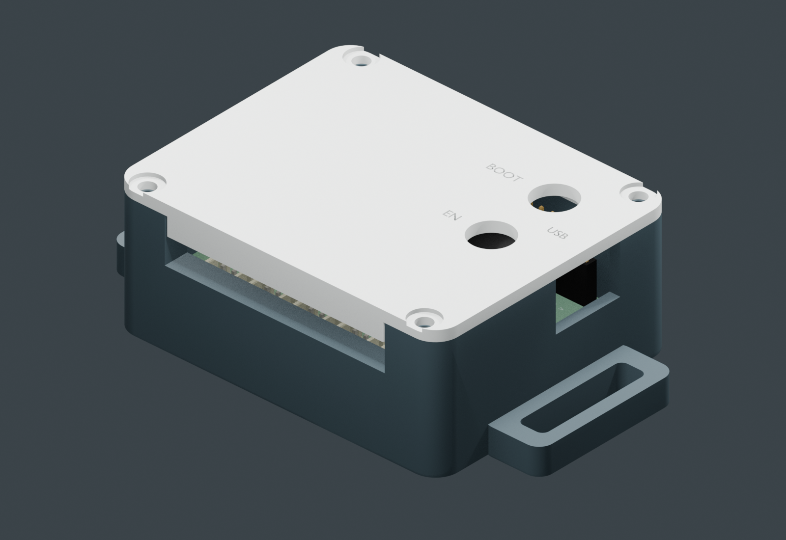

# AISL-A enclosure V3 (for carrier PCB v1)

Generated 2026-11-18. **Fit prototype: nothing printed, no real board measured.** It is built
from the PCB design files in `hardware/pcb/v1/`, so it is only as right as that PCB design.
V2 (`../v2/`) is for the old 90 × 60 mm perfboard and stays untouched.

**The master model is the FreeCAD one in `freecad/`** (JP, 2026-11-18: "Redo in FreeCAD").
The Blender files in this folder are the first draft of the same design and are kept only for
the rendered pictures. Print from `freecad/exports/`.



## Size

| | mm |
|---|---|
| Body | **74 × 58.9 × 29.4** |
| Overall with the two strap loops | **98 × 58.9 × 29.4** |
| V2, for comparison | 122 × 86 × 42 body, 146 long with loops |

## Files

| File | What |
|---|---|
| `freecad/AISL-A_Enclosure_V3.FCStd` | **Open this in FreeCAD.** Four objects: Base, Lid, the populated PCB imported from KiCad, and a USB-plug stand-in. |
| `freecad/build_enclosure_v3_freecad.py` | **The source.** Change numbers in `P` at the top and re-run (command below). |
| `freecad/exports/01_base.stl` | Print file. Tub, strap loops, PCB corner pads, USB notch, flex-wire notch. Print open side up. |
| `freecad/exports/02_lid.stl` | Print file. Already flipped: print as is, outer face on the bed. |
| `freecad/AISL-A_V3_Print_Files.zip` | Both STLs, the drawing, the STL checker and its report. |
| `freecad/step/01_base.step`, `02_lid.step` | Exact CAD geometry of the two parts (opens in any CAD program). |
| `freecad/step/AISL-A_V3_assembly.step` | Base + lid + the populated PCB in one file. |
| `freecad/drawings/AISL-A_V3_views.svg` | A4 sheet: top, front and right views with the main dimensions, for the report. |
| `freecad/validation.json` | Solid checks and the collision check against the real PCB model. |
| `freecad/verify_stl.py`, `stl_validation.json` | Independent STL check without FreeCAD. |
| `build_enclosure_v3.py`, `AISL-A_Enclosure_V3.blend`, `*_preview.png`, `validation.json` | Blender version: pictures only. Keep its numbers equal to the FreeCAD script. |

Import the STLs into the slicer at **100 %, millimetres**.

## Layout (mm)

Origin = centre of the carrier PCB, Z = 0 at the underside of the box. +X = USB end,
−Y = flex-connector edge. A PCB coordinate (x, y) from `hardware/pcb/v1` is (x − 1.0, 8.05 − y) here.

| Feature | Value |
|---|---|
| Walls | 2.4 at the two short ends (±X), 5.6 on the long sides (±Y, they take the lid screws) |
| Floor / lid | 2.4 / 2.4 |
| Cavity | 69.2 × 47.7 (PCB 68 × 46.5 + 0.6 all round), corner radius 3 |
| PCB underside / top | Z = 5.9 / 7.5 (3.5 mm under the board for solder joints) |
| Lid underside | Z = 27.0 (19.5 mm above the PCB top) |
| PCB corner pads + M3 pilots (2.6 mm) | (±30.5, +19.55) and (±30.5, −19.75) |
| Lid screws, M3 pilots (2.6 mm) in the long walls | (±31.5, ±26.65) |
| USB notch | +X wall, 16 wide, centre Y = 8.05, from Z = 16.0 up to the lid |
| Flex-wire notch | −Y wall, 50 wide, centre X = 0, from Z = 17.0; the lid apron closes the top 4 mm, leaving a 50 × 6 slot |
| BOOT / EN holes in the lid | 9 mm, at (22.2, 15.9) / (22.2, 0.2) |
| Strap slots | 26 × 6, centred X = ±43, for a 20–25 mm strap, loops 6 mm thick |
| Edges | 0.6 mm chamfer round the bottom of the base and the top of the lid |

Why it is 29.4 mm tall: the DevKit sits on 8.5 mm sockets (JP's choice, so it can be swapped),
and the USB plug's rubber body needs room above the DevKit. Soldering the DevKit straight to
the PCB would take about 8 mm off.

## Hardware

- 4 × M3 × 6 pan-head screws for the PCB (self-tapping into the printed pilots). Nylon is
  better at the two holes next to the ESP32 antenna (−X end).
- 4 × M3 × 10 pan-head screws for the lid.
- 20–25 mm Velcro strap. Optional 2 mm foam pad under the box.

## Assembly order

1. Solder the PCB. Plug in the DevKit and the five flex connectors.
2. Lower the PCB into the base (USB toward the notch on the short end) and fit the 4 PCB screws.
3. Lay the flex wires in the long-side notch.
4. Close the lid (its apron drops into the wire notch) and fit the 4 lid screws.

## Checks done (on the computer only)

FreeCAD (`freecad/validation.json`):
- Base and lid are each one valid, closed solid. Base 36 258 mm³, lid 11 464 mm³.
- **0 mm³ overlap** between base and lid, and between each of them and all **254 solids of
  the real PCB model** exported from KiCad (board, sockets, DevKit, MPU6050, JSTs, resistors,
  capacitors, headers), plus a 12 × 8.5 mm USB-plug stand-in.
- Tallest part to the lid underside: 3.62 mm. Lowest pin to the floor: 1.69 mm. PCB edge to wall: 0.6 mm.
- Both STLs are closed with no bad triangles (checked by FreeCAD and again by `verify_stl.py`).

Blender (`validation.json` here) reached the same result earlier against 41 stand-in boxes,
and its part volumes agree with FreeCAD's within 0.4 % (the difference is edge rounding).

## Not checked, do before a final print

- **The PCB itself is unverified** (see `hardware/pcb/v1/README.md`). Do its paper fit check first.
- The DevKit and MPU6050 3D models are downloaded SnapEDA models placed at nominal heights
  (8.5 mm sockets). A real board can differ by a millimetre or so.
- BOOT and EN hole positions were read off the DevKit 3D model, and which button is which is
  from memory of the DevKitC layout (EN on the 3V3/EN pin side). Check on the real board.
- USB plug: opening is 16 × 11 mm and the socket sits about 10.5 mm inside the wall. A plug
  with a very fat or very short rubber body may not reach.
- Screw pilots (2.6 mm for M3) and the 0.3 mm lid clearance depend on the printer. Print the
  base first and test one screw before printing the lid.
- Strap loop strength, wearing comfort, and whether the 50 × 6 mm slot is enough for the wires.
- No strain relief for the flex wires yet (V2 had cable-tie anchors).

## Rebuild

FreeCAD (master), from `freecad/`. FreeCAD does not need to be open:

```powershell
& "$env:LOCALAPPDATA\Programs\FreeCAD 1.1\bin\freecadcmd.exe" build_enclosure_v3_freecad.py
```

About 15–30 s. Then `python verify_stl.py` and rebuild the print zip. If the PCB changes,
re-export `hardware/pcb/v1/exports/aisl_glove_carrier_assembled.step` first: the script reads
it for the collision check and the assembly STEP.

Blender (pictures), from this folder:

```powershell
& "C:\Program Files\Blender Foundation\Blender 5.2\blender.exe" --background --factory-startup --python build_enclosure_v3.py
```

## What the FreeCAD file is and is not

- It holds real CAD solids, so you can measure anything, section it, make TechDraw drawings,
  and export STEP for any other CAD program.
- It is **not a click-to-edit parametric model**: the solids are generated by the script, so
  there is no sketch/pad history in the tree. To change a dimension, change it in the script
  and re-run. You can still add or cut features by hand in FreeCAD on top of the solids, but
  a re-run of the script overwrites the file.
- Objects have no colours and all four are visible when the file opens (the script runs
  without the FreeCAD window, which is where colours and visibility live). Hide
  `PCB_assembly` and `USB_plug_envelope` with the space bar to see the box alone.
