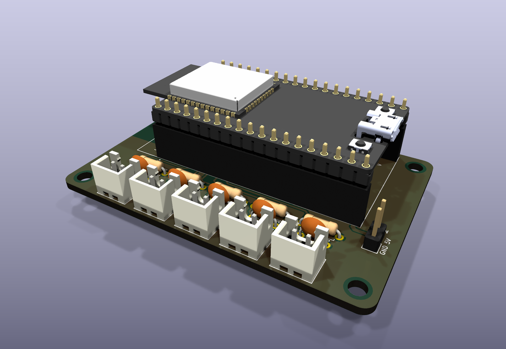
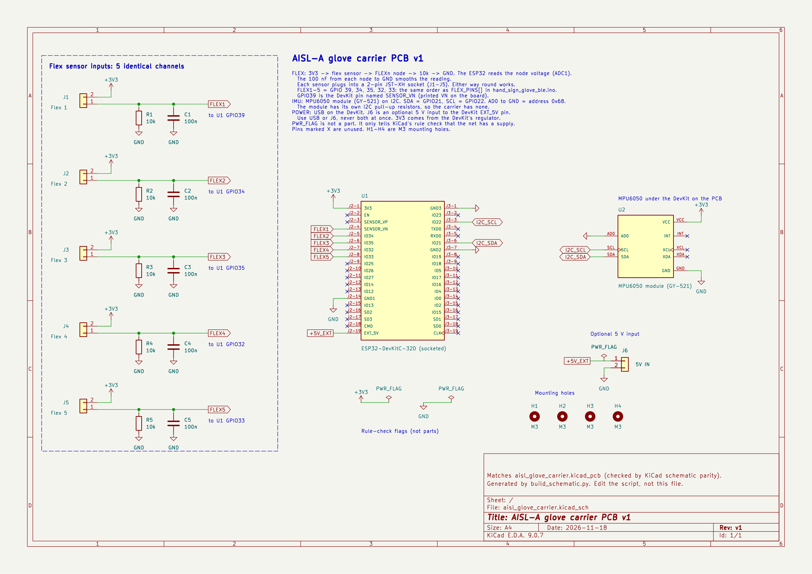

# AISL-A glove carrier PCB v1

Generated 2026-11-18. **Not ordered, not built, not physically checked yet.** Design rules
pass (KiCad 9.0.7 DRC: 0 violations, 0 unconnected) and the board matches its schematic
(KiCad schematic parity: 0 issues), but a human still has to do the fit checks at the bottom
of this file before sending it to a fab.

Background, JP's decisions and the open questions are in `THESIS/HANDOFF.md` section 13.

## What it is

A 2-layer, all through-hole carrier board, **68 × 46.5 mm**, 1.6 mm FR4, hand-solderable.

- **U1** ESP32-DevKitC-32D plugs into two 1×19 female header sockets.
- **U2** MPU6050 module (GY-521) is soldered on its 1×8 header **underneath the DevKit**,
  between the two socket rows. Unplug the DevKit to reach it.
- **J1–J5** five 2-pin JST-XH sockets along one long edge, one per flex sensor, each with a
  10 k resistor (R1–R5) and a 100 nF capacitor (C1–C5) behind it.
- **J6** optional 1×2 pin header `5V IN` (DevKit `EXT_5V` pin + GND) for a future battery pack.
- **H1–H4** four M3 mounting holes (3.2 mm).



## Schematic



`aisl_glove_carrier.kicad_sch` is in the same KiCad project as the board, so opening
`aisl_glove_carrier.kicad_pro` in KiCad 9 gives both. Printable copy:
`schematic/aisl_glove_carrier_schematic.pdf`. It was redrawn on 2026-11-18 to match this
board and replaces the older drawing in `Glove kicad/glove/` (kept there untouched).

How to read it: each flex sensor sits between 3V3 and a node, and a 10 k resistor sits
between that node and GND. Bending the sensor changes its resistance, so the node voltage
changes, and the ESP32 measures that voltage. The 100 nF capacitor steadies the reading.
Boxes with a name (`FLEX1`, `I2C_SCL`, ...) are the same wire wherever the name appears.
Pins with an X are unused.

## Files

| Path | What |
|---|---|
| `build_carrier_pcb.py` | **The source of the board.** Edit this, not the `.kicad_pcb`. |
| `build_schematic.py` | **The source of the schematic.** Edit this, not the `.kicad_sch`. Also runs ERC and exports the PDF/SVG. |
| `aisl_ids.py` | Shared by both scripts so a symbol and its footprint carry the same ID. |
| `aisl_glove_carrier.kicad_sch` | The schematic, opens in KiCad 9. Regenerated (overwritten) by the script. |
| `schematic/` | Schematic as PDF, PNG and SVG. |
| `sym-lib-table`, `lib/aisl.kicad_sym` | Project symbol library (DevKit, MPU6050 module), generated by the script. |
| `lib/snapeda_original_symbols/` | Untouched SnapEDA symbols (copies of `Glove kicad/…`). |
| `check_schematic_vs_pcb.py` | Compares schematic and board pad by pad; writes `checks/schematic_vs_pcb.json`. |
| `compare_gerbers.py` | Compares two Gerber files as geometry (`compare_gerbers.py OLD NEW`), to prove a rebuild changed nothing. |
| `aisl_glove_carrier.kicad_pcb` / `.kicad_pro` | The board, opens in KiCad 9. Regenerated (overwritten) by the script. |
| `fp-lib-table`, `lib/aisl.pretty/` | Project footprint library, generated by the script. |
| `lib/snapeda_original.pretty/` | Untouched SnapEDA footprints (copies of `Glove kicad/…`). |
| `lib/3d/` | STEP models of the DevKit and the MPU6050 module (copies of `Glove kicad/…`). |
| `layout_summary.json` | Pad coordinates, hole positions and board size written by the script. |
| `fab/aisl_glove_carrier_gerbers.zip` | **Upload this to the fab** (7 Gerber layers + PTH and NPTH drill files). |
| `fab/gerbers/` | The same files unzipped, plus drill map PDFs. |
| `fab/BOM.csv` | Parts list. |
| `exports/aisl_glove_carrier_assembled.step` | 3D model of the populated board, for the enclosure. |
| `exports/aisl_glove_carrier_bare_board.step` | Board only. |
| `checks/drc.json`, `checks/drc_report.txt` | DRC results, including schematic parity. |
| `checks/erc.json`, `checks/erc_report.txt` | ERC (electrical rules check) of the schematic. |
| `checks/schematic_netlist.xml` | Netlist exported from the schematic; the board script reads it. |
| `checks/print_1to1_pin_fit_check.pdf` | Print at **100 % / actual size** for the paper fit check. |
| `renders/` | 01 top, 02 top with DevKit removed, 03 bottom, 04/05 perspective, 06 side. |

## Rebuild

Use KiCad's own Python (not the MediaPipe venv). From this folder:

```powershell
& "C:\Program Files\KiCad\9.0\bin\python.exe" build_schematic.py
& "C:\Program Files\KiCad\9.0\bin\python.exe" build_carrier_pcb.py
& "C:\Program Files\KiCad\9.0\bin\kicad-cli.exe" pcb drc --schematic-parity --format json --severity-all -o checks/drc.json aisl_glove_carrier.kicad_pcb
& "C:\Program Files\KiCad\9.0\bin\python.exe" check_schematic_vs_pcb.py
```

Schematic first: the board script reads the netlist it writes. All three checks must stay at
zero: ERC (`checks/erc_report.txt`), DRC with parity (`checks/drc.json`) and
`check_schematic_vs_pcb.py`. If you change the circuit, change it in **both** build scripts.

Then re-export Gerbers, drill, STEP and renders with `kicad-cli pcb export …` / `pcb render`
(exact commands are in `THESIS/HANDOFF.md` section 13.7). `AISL_VARIANT=no_devkit` makes a
second board file without the DevKit 3D model, used only for renders 02 and 05; delete it after.

## Netlist (read back from the generated board)

| Net | Pins |
|---|---|
| `+3V3` | DevKit `3V3` (J2-1), MPU `VCC`, pin 2 of J1–J5 |
| `GND` | DevKit `GND` ×3 (J2-14, J3-1, J3-7), MPU `GND` and `AD0`, R1–R5 pin 2, C1–C5 pin 2, J6 pin 2 |
| `FLEX1` | DevKit GPIO39 / `SENSOR_VN` (J2-4), J1 pin 1, R1, C1 |
| `FLEX2` | DevKit GPIO34 (J2-5), J2 pin 1, R2, C2 |
| `FLEX3` | DevKit GPIO35 (J2-6), J3 pin 1, R3, C3 |
| `FLEX4` | DevKit GPIO32 (J2-7), J4 pin 1, R4, C4 |
| `FLEX5` | DevKit GPIO33 (J2-8), J5 pin 1, R5, C5 |
| `I2C_SCL` | DevKit GPIO22 (J3-3), MPU `SCL` |
| `I2C_SDA` | DevKit GPIO21 (J3-6), MPU `SDA` |
| `+5V_EXT` | DevKit `EXT_5V` (J2-19), J6 pin 1 |

FLEX1…FLEX5 follow the firmware order `FLEX_PINS[5] = {39, 34, 35, 32, 33}`, so **no firmware
change is needed**. Which finger is flex1 is whatever the glove wiring is today; keep it.

Differences from the old KiCad 10 schematic in `Glove kicad/glove/` (out of date, replaced by
the schematic in this folder): filter caps go to **GND** instead of 3V3, flex sensors are
connectors J1–J5, J6 is new, and the references are renumbered (old R2/R4/R6/R8/R10 = 10 k,
here R1–R5).

The 29 unused pads (26 on the DevKit, `INT`, `XCL`, `XDA` on the MPU) each sit on their own
one-pad net named `unconnected-(...)`. That is KiCad's way of saying "deliberately not
connected" and adds no copper.

## Geometry (mm)

Coordinates are relative to the centre of the DevKit footprint, +X toward the USB end, +Y
toward the flex-connector edge. On the KiCad sheet add (100, 80).

| Item | Value |
|---|---|
| Outline | X −33 … +35, Y −15.2 … +31.3 (68 × 46.5), 2.5 mm corner radius |
| Mounting holes (3.2 mm) | (−29.5, −11.5), (31.5, −11.5), (−29.5, 27.8), (31.5, 27.8): **61 × 39.3 mm** pattern |
| DevKit socket rows | Y = ±12.7 (25.4 mm apart), pins X = −19.76 … +25.96, 2.54 pitch |
| DevKit body overhang | X −27.4 … +27.5; antenna at −X, USB at +X |
| MPU6050 module centre | (−5.79, 0); header row at Y = +6.33, `VCC` at X = −14.68 … `INT` at X = +3.10 |
| JST pins | Y = 27.1; cells centred X = −19, −9, 1, 11, 21 (J1 … J5) |
| 5V header J6 | 5V (30.5, 15.0), GND (30.5, 17.54) |
| Heights above the carrier top (nominal) | JST 7.0; socket top 8.5; MPU parts ≈ 5.5, its header pins ≈ 8.6; DevKit PCB 11.0–12.6; tallest DevKit part ≈ 16 |
| Below the carrier | solder joints / trimmed leads ≈ 2 |

Tracks: 0.4 mm signals, 0.6 mm 3V3, 0.8 mm 5 V, no vias. Ground pour on both sides, pulled back
under the ESP32 antenna and round every non-plated hole.

## Must check before ordering

1. **Print `checks/print_1to1_pin_fit_check.pdf` at 100 %** and lay the real parts on it:
   - DevKit: 19 pins per side and rows 25.4 mm apart. (A 30-pin "DOIT" board will not fit.)
   - MPU6050 module: with the header on the printed row, the label order must read
     `VCC GND SCL SDA XDA XCL AD0 INT` from the antenna side to the USB side, **and the
     module body must point toward the top socket row**, not toward the flex connectors.
     The pin order comes from an unverified SnapEDA footprint. If the body points the other
     way it will hit the bottom socket row and the footprint has to be flipped in the script.
2. Height: the MPU module has to fit under the DevKit (≈ 11 mm free). Fine with a standard
   2.54 mm header, **not** if the module sits on a tall socket.
3. Flex sensor leads need JST XH plugs (housing XHP-2). Direction does not matter.
4. Decide with Paulo whether the caps to GND change is acceptable (HANDOFF 13.2 item 1).
5. Have someone open the board in KiCad and look it over.

## Known limits

- Schematic and board are two generated files that are checked against each other, not one
  drawn from the other. Do not use KiCad's "Update PCB from Schematic" to change the circuit:
  the next script run overwrites both files. Change the two scripts instead.
- J6 feeds the DevKit's 5V pin. Power the board from USB **or** from J6, not both at once.
- 3D model heights are nominal (DevKit model placed for an 8.5 mm socket + 2.54 mm header).
- The IMU sits under the ESP32 and will warm up a little with it. Zero it (CAL) after the
  board has been on for a few minutes.
- Use nylon screws at H1/H3 if possible: they are next to the antenna.

## Ordering from Aivon (aivon.com), chosen by JP 2026-11-18

Checked on their site on 2026-11-18. The **only file they need for a bare board** is
`fab/aisl_glove_carrier_gerbers.zip` (they accept zip/rar under 10 MB; ours is about 80 KB).
Do not put the `.kicad_pcb` in the same zip. No BOM or pick-and-place file is needed, because
we solder the parts ourselves (those are only for their assembly service).

On their "PCB Quote" page (`online-pcb-quote-new.html`) upload the zip, then set:

| Field | Value |
|---|---|
| Material Type | FR-4 |
| Layers | 2 |
| Dimensions | 46.5 × 68 mm |
| Board Type | Single PCB |
| Quantity | 5 (the minimum) |
| Thickness | 1.6 |
| Outer Copper | 1oz |
| Solder Mask / Silkscreen | any / white (silkscreen must contrast with the mask) |
| Min Spacing | 6/6mil↑ (our smallest gap is 0.25 mm ≈ 10 mil, tracks ≥ 0.4 mm) |
| Min Hole Size | 0.3mm↑ (our smallest hole is 0.8 mm) |
| Via Process | leave default (the board has no vias) |
| Surface Finish | HASL Lead Free (or HASL with Lead: cheaper and easier to hand-solder) |
| Project File Confirm | Yes (they send their production file for you to check before making it) |

Their review will show 78 plated holes and 6 non-plated 3.2 mm holes; that is correct.
Prices on the site exclude customs duty and VAT. Nobody has uploaded or ordered anything yet.
